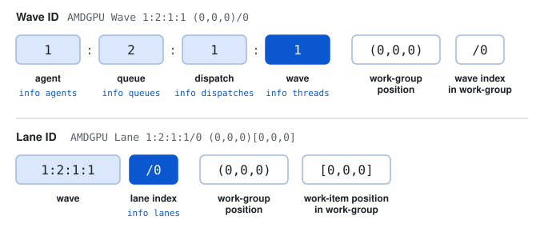

---
myst:
  html_meta:
    "description lang=en": "Learn how ROCgdb represents GPU execution state: agents, queues, dispatches, waves as threads, and lanes as work-items, and which command shows each one."
    "keywords": "ROCgdb wave, ROCgdb lane, GPU threads, agents, queues, dispatches, AMDGPU wave"
---

(rocgdb-gpu-execution-state)=

# GPU execution state in ROCgdb

ROCgdb extends GDB's model of threads and frames to cover the GPU. This page defines the GPU terms that ROCgdb uses, and maps each one to the command that shows it, so you know which command to run when you're stopped in a kernel.

## Key terms

The terms build on each other, so read them in order. Other pages link to these definitions the first time they use a term.

```{glossary}
HIP
  The C++ GPU programming interface that you write applications against. A HIP application has host code that runs on the CPU and kernels that run on the GPU.

Kernel
  A function that runs on the GPU. One kernel launch runs many copies of the function in parallel.

HSA agent
  A device that can run kernels, such as an AMD GPU. ROCgdb shortens this to *agent*.

Work-item
  One copy of a kernel running on the GPU, with its own variables. A kernel launch creates many work-items.

Work-group
  A set of work-items that run together on one part of the GPU and can share fast local memory.

Wave
  A set of work-items from one work-group that the hardware runs together. The work-items in a wave share one instruction stream, which is called running in *lockstep*. When the work-items take different branches, the hardware masks off the lanes that don't take the current branch, so only the active lanes run each instruction. Also called a *wavefront*.

Lane
  The slot that a work-item occupies in its wave, numbered from 0. In ROCgdb, you select a lane to inspect the work-item in that slot.
```

The hardware runs one instruction at a time for a whole wave, and it applies that instruction to every *active* lane at once. This is SIMD (single instruction, multiple data). Because each lane has its own variables, a lane behaves like an independent thread, which is why this model is also called SIMT (single instruction, multiple threads). A lane is inactive while its work-item is on a different branch from the rest of the wave, so `info lanes` can show both active and inactive lanes.

## Concept map

```{list-table}
:header-rows: 1
:widths: 20 45 35

* - Concept
  - Description
  - Command
* - Agent
  - An AMD GPU (or other {term}`HSA agent`) in the system
  - `info agents`
* - Queue
  - An HSA queue that receives kernel dispatches
  - `info queues`
* - Dispatch
  - One kernel launch, including grid and workgroup size
  - `info dispatches`
* - Wave
  - A {term}`wave`, which ROCgdb lists as a GDB thread named `AMDGPU Wave`
  - `info threads`, `thread <id>`
* - Lane
  - One {term}`lane` of a wave, which you can select to inspect one {term}`work-item`
  - `info lanes`, `lane <id>`
* - Registers
  - The registers of the current wave
  - `info registers`, `info all-registers`
* - Address spaces
  - GPU memory regions, such as `global`, `local`, `private_wave`, and `private_lane`
  - `x <space>#<address>`
```

The `x` command takes an optional format after a slash, so `x/4xw global#<address>` prints four words of global memory in hexadecimal. Without a format, `x global#<address>` prints one word in hexadecimal. If you leave out `<space>#`, ROCgdb uses the default address space of the AMD GPU architecture, which is `global`. The `local` space is the memory shared by a work-group. The `private_lane` space is the private memory of one lane. The `private_wave` space is the unswizzled backing memory for the `private_lane` space of a wave. The `generic` space can reach the `global`, `local`, and `private_lane` spaces. For more examples, see {ref}`rocgdb-essential-commands`.

## Waves are threads

ROCgdb lists each {term}`wave` in `info threads` next to the host CPU threads, and you select one with `thread <id>`. After you select a wave, commands such as `info registers` and `backtrace` apply to that wave.

The wave ID in the `Target Id` column encodes where the wave sits in the system. In `AMDGPU Wave 1:2:1:1 (0,0,0)/0`, `1:2:1:1` gives the agent, queue, dispatch, and wave numbers. `(0,0,0)` gives the position of the work-group in the dispatch, and `/0` gives the wave's index within the work-group.

<a href="../_static/rocgdb-wave-id.svg" target="_blank" rel="noopener" title="Open the diagram in a new tab"></a>

## Lanes are work-items

A wave has one lane for each of its work-items, and the lanes run in lockstep. Lanes that take a different branch are inactive until the wave reaches code that they run. When you want to look at the values for one work-item, select its lane with `lane <id>`. Variable values you print after that belong to the selected lane. Use `info lanes` to list the lanes of the current wave and their state.

A lane ID extends the wave ID. In `AMDGPU Lane 1:2:1:1/0 (0,0,0)[0,0,0]`, `1:2:1:1` identifies the wave, `/0` is the lane index, `(0,0,0)` is the work-group position, and `[0,0,0]` is the position of the work-item within the work-group.

## Related information

```{eval-rst}
* To use these commands in a session, see :ref:`rocgdb-first-hip-kernel`.
* For the command syntax and more sample output, see :ref:`rocgdb-essential-commands`.
* For the complete model, see `Debugging on AMD GPU <../ROCgdb/gdb/doc/gdb/AMD-GPU.html>`_ in the ROCgdb user guide.
```
