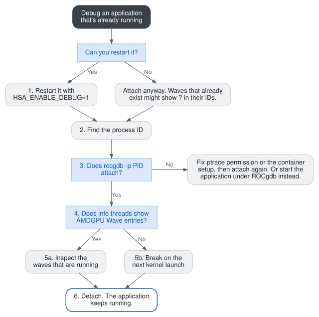

---
myst:
  html_meta:
    "description lang=en": "Attach ROCgdb to a running HIP application, inspect its GPU waves or stop at its next kernel launch, and detach without stopping the application."
    "keywords": "ROCgdb attach, rocgdb -p, HSA_ENABLE_DEBUG, ptrace_scope, running process, detach, gcore"
---

% TODO(engineering validation): Items still open from the 10.2 review.
% - Step 3: confirm the advice for ptrace_scope. The page tells readers how to
%   check the setting and leaves changing it to the administrator.
% - Step 5a tip: the hung-kernel procedure was corrected from a test on an
%   MI300X. Confirm on a gfx11 or gfx12 GPU.
% - Step 4: the work-group cluster wave ID in the Interpret table was captured
%   on gfx1250-strict. Confirm the Cluster column wording for `info
%   dispatches` against the manual.
% - If ROCgdb pull request #182 (attach without forward progress) merges
%   before 10.2, check whether anything users see on this page changes.
% - Captures requested from Luis on 10 November 2026 and still open: steps 3,
%   5b and 6 describe output (a clean `rocgdb -p` attach, the breakpoint
%   message after `break <kernel>`, and the `gcore` and `detach` output) but
%   show none. Only the step 4 wave line is a real capture.
% - Recorded for a later revision, not 10.2: `sudo rocgdb -p`, and GPU core
%   dumps while attached.

(rocgdb-attach)=

# Attach to a running process

Attach ROCgdb to a HIP application that's already running, look at its GPU waves or stop at its next kernel launch, and detach without stopping the application.

## When to use this page

Use this page when:

* The application takes a long time to reach the problem.
* Something you can't wrap with `rocgdb`, such as a job launcher or service, starts the application.
* The application seems to hang and you want to see where.

If you can start the application yourself, use {ref}`Debug your first HIP kernel <rocgdb-first-hip-kernel>` instead. Starting under ROCgdb shows more.

## Prerequisites

* ROCgdb is installed. See {ref}`Install ROCm Debugger (ROCgdb) <rocgdb-installation>`.
* You're logged in with the account that runs the application.
* The application is built with `-ggdb`, so ROCgdb can show source lines.

## How the steps fit together

<a href="../_static/rocgdb-attach-steps.svg" target="_blank" rel="noopener" title="Open the diagram in a new tab"></a>

(rocgdb-attach-env)=

## 1. Start the application with HSA_ENABLE_DEBUG=1

On some GPUs, such as gfx90a, waves that started before ROCgdb attached can't report their dispatch or work-group position. Setting `HSA_ENABLE_DEBUG=1` before the application starts makes that information available on every GPU. You need it only on GPUs where ROCgdb shows `?` ({ref}`step 4 <rocgdb-attach-threads>`). The cost is a small increase in launch time for very short-lived waves.

```shell
$ HSA_ENABLE_DEBUG=1 ./saxpy
```

**Expected result:** The application runs as it normally does.

:::{admonition} If you can't restart the application

Skip this step. Everything else on this page still works. Waves that already exist might show `?` in their IDs, and waves created after you attach report their position normally.
:::

(rocgdb-attach-pid)=

## 2. Find the process ID

```shell
$ pgrep -a saxpy
```

**Expected result:** One line with the process ID and command, for example `48213 ./saxpy`.

:::{admonition} If this fails

If several processes are listed, for example one per MPI rank, pick one and attach to that. One ROCgdb session can't debug two GPU applications at once.
:::

(rocgdb-attach-attach)=

## 3. Attach ROCgdb

```shell
$ rocgdb -p <process-id>
```

ROCgdb pauses the whole application, CPU threads and GPU waves, and shows the `(gdb)` prompt. You can also attach from inside ROCgdb with `attach <process-id>`.

**Expected result:** ROCgdb reads the application's symbols and shows the `(gdb)` prompt with no `amd-dbgapi` warnings.

:::{admonition} If this fails

* `ptrace: Operation not permitted.` The kernel's Yama `ptrace_scope` setting is `1`, the Ubuntu default. It lets a debugger attach only to processes it started, even when they run as the same user. Check the setting with `cat /proc/sys/kernel/yama/ptrace_scope` (see [Yama ptrace_scope](https://www.kernel.org/doc/html/latest/admin-guide/LSM/Yama.html)). Relaxing it is a system-wide security decision for your administrator, so start the application under `rocgdb` instead of attaching.
* **Inside a container**, the container needs `--cap-add=SYS_PTRACE --security-opt seccomp=unconfined`. See the {ref}`container row <rocgdb-kl-container>` in Known limitations.
* `At least one agent is busy` or another `amd-dbgapi` warning: use the {ref}`warnings table <rocgdb-kl-warnings>` in Known limitations.
* **A restriction about cooperative groups or compute unit (CU) masking** on gfx1100, gfx1101, or gfx1102: there's no workaround on these GPUs.
:::

(rocgdb-attach-threads)=

## 4. See what's running

```shell
(gdb) info threads
```

Wave line captured on an AMD Instinct MI210 (gfx90a), for an application started without `HSA_ENABLE_DEBUG=1`. The CPU threads are listed before it:

```text
  Id   Target Id                                       Frame
  ...
  5    AMDGPU Wave 1:1:?:1 (?,?,?)/?   0x... in spin_kernel (seconds=60, out=0x...) at attach_app.hip:12
```

The `?` depends on the GPU. On gfx90a it's in the dispatch field (`1:1:?:1`), and the line has no quoted name. gfx942, gfx1100, and gfx1201 print complete IDs even without `HSA_ENABLE_DEBUG=1`, with the kernel name in quotes, for example `AMDGPU Wave 1:1:1:1 (0,0,0)/0 "spin_kernel"`.

**Expected result:** You see the CPU threads and, if a kernel is running right now, one or more `AMDGPU Wave` entries. If you see waves, go to {ref}`step 5a <rocgdb-attach-inspect>`. If you don't, go to {ref}`step 5b <rocgdb-attach-next-launch>`.

(rocgdb-attach-inspect)=

## 5a. Inspect the waves that are running

Select a wave, see where it is, and print its values as you would in any kernel stop.

```shell
(gdb) thread <wave-thread-id>
(gdb) backtrace
(gdb) info lanes
(gdb) lane <lane-id>
(gdb) print <variable>
```

**Expected result:** `backtrace` shows a frame in your kernel source, and the variables print values for the lane you selected.

:::{admonition} If this fails

If there's no source line, the GPU code was built without `-ggdb`. You can still see the machine instructions with `x/5i $pc`. Rebuild with `-ggdb` for next time.
:::

:::{tip}
If the kernel looks hung, find out whether it's still moving:

1. Run `thread apply all -q print $pc`, then `continue`, press Ctrl-C after a few seconds, and run the print again. A spinning wave's program counter (PC) moves, and a wave waiting at a barrier stays put.
2. To look inside one wave, run `info lanes`, then `lane apply all print <loop-variable>`.
3. Run `continue`, press Ctrl-C, and select the wave again with `thread <wave-thread-id>`. After Ctrl-C, ROCgdb selects a CPU thread.
4. Print the variable again. Among active lanes, a changing value means the lane is still in the loop, and an unchanged value means it left the loop or is waiting.
:::

(rocgdb-attach-next-launch)=

## 5b. Stop at the next kernel launch

Attaching can't go back to kernels that have already finished, but you can stop the next one.

```shell
(gdb) set breakpoint pending on
(gdb) break saxpy_kernel
(gdb) continue
```

**Expected result:** ROCgdb stops when the kernel next launches, and you can carry on from step 5 of {ref}`Debug your first HIP kernel <rocgdb-first-hip-kernel-select-wave>`.

If the application has already loaded the GPU code, for example because any kernel in it has run, the breakpoint resolves right away. If the kernel is in a code object that loads later, the breakpoint stays `<PENDING>` until that code object loads.

:::{admonition} If this fails

If ROCgdb never stops, the kernel isn't launched again. Press Ctrl-C, run `detach`, and either attach earlier next time or start the application under ROCgdb. For other causes, see {ref}`Kernel breakpoint isn't hit <rocgdb-troubleshoot-breakpoint-not-hit>`.
:::

(rocgdb-attach-detach)=

## 6. Detach

If you need a core file for later, save it before you detach. While ROCgdb is attached, the ROCm runtime can't write its own GPU core dump, but ROCgdb can:

```shell
(gdb) gcore saxpy.core
(gdb) detach
```

**Expected result:** ROCgdb prints `Detaching from program` and the application keeps running. `quit` also detaches from a process you attached to.

## Interpret what you see

```{list-table}
:header-rows: 1

* - What you see
  - What it means
  - What to do
  - Read more
* - `ptrace: Operation not permitted.`
  - Linux blocked the attach (Yama `ptrace_scope` is `1`).
  - Start the application under ROCgdb. Changing `ptrace_scope` is for your administrator ({ref}`step 3 <rocgdb-attach-attach>`).
  - [Yama ptrace_scope](https://www.kernel.org/doc/html/latest/admin-guide/LSM/Yama.html)
* - `AMDGPU Wave 1:1:?:1 (?,?,?)/?`
  - The wave started before ROCgdb attached, on a GPU such as gfx90a, and the application wasn't started with `HSA_ENABLE_DEBUG=1`.
  - Nothing else is affected. Next time, start the application with `HSA_ENABLE_DEBUG=1`.
  - [Attaching restrictions](https://rocm.docs.amd.com/projects/ROCgdb/en/latest/ROCgdb/gdb/doc/gdb/AMD-GPU.html#AMD-GPU-Attaching-Restrictions)
* - A wave ID with two coordinate groups, such as `AMDGPU Wave 1:2:1:3 (0,0,0)/(1,0,0)/0` (captured on gfx1250-strict)
  - The kernel uses work-group clusters. The first group is the cluster, the second is the work-group's position within the cluster, and the last number is the wave's index within the work-group. Lane IDs use the same form. In `info dispatches`, the Cluster column is in work-items, not work-groups: a cluster of two 64-work-item work-groups shows `[128,1,1]`.
  - Nothing to fix.
  - [Target identifiers](https://rocm.docs.amd.com/projects/ROCgdb/en/latest/ROCgdb/gdb/doc/gdb/AMD-GPU.html#AMD-GPU-Heterogeneous-Entity-Target-Identifies-and-Convenience-Variables)
* - No `AMDGPU Wave` entries
  - No kernel is running right now.
  - Break on the next launch ({ref}`step 5b <rocgdb-attach-next-launch>`).
  - {ref}`Waves are threads <rocgdb-waves-are-threads>`
* - The kernel breakpoint never stops after `continue`
  - The kernel doesn't launch again.
  - Start the application under ROCgdb instead.
  - {ref}`Kernel breakpoint isn't hit <rocgdb-troubleshoot-breakpoint-not-hit>`
* - Ctrl-C doesn't interrupt ROCgdb
  - Only a GPU wave was resumed with `scheduler-locking` on.
  - End the `rocgdb` process. See {ref}`Known limitations <rocgdb-kl-limitations>`.
  - [AMD GPU restrictions](https://rocm.docs.amd.com/projects/ROCgdb/en/latest/ROCgdb/gdb/doc/gdb/AMD-GPU.html#AMD-GPU-Restrictions)
* - No `gpucore` file after a crash while ROCgdb was attached
  - Expected. The runtime can't write a GPU core dump while ROCgdb is attached.
  - Use `gcore` before you detach ({ref}`step 6 <rocgdb-attach-detach>`).
  - [AMD GPU core dumps](https://rocm.docs.amd.com/projects/ROCgdb/en/latest/ROCgdb/gdb/doc/gdb/AMD-GPU.html#AMD-GPU-core-dumps)
```

## Report a problem

Before you open an issue, try starting the application under ROCgdb and reproducing the same problem. If it happens only when you attach, say so in the issue, because that narrows the problem down a lot. Then follow the routing and template in {ref}`Known limitations <rocgdb-kl-report>`.

:::{admonition} Evidence to collect

* The evidence from {ref}`Known limitations <rocgdb-kl-report>`: `rocgdb --version`, `rocminfo | grep gfx`, OS and kernel, and a session log.
* How the application was started, including environment variables such as `HSA_ENABLE_DEBUG`.
* The full output of `rocgdb -p <process-id>`, then `info threads` and `info agents`.
* Whether the problem also happens when you start the application under ROCgdb.
:::

Open the issue on [ROCm/ROCgdb issues](https://github.com/ROCm/ROCgdb/issues).

## You are done when

You've attached to the application, inspected its running waves or stopped at its next kernel launch, and detached with the application still running.

## Related information

* {ref}`Commands by task: attach to a running process <rocgdb-essential-commands>`
* {ref}`Debug your first HIP kernel <rocgdb-first-hip-kernel>`
* [Debugging an already-running process](https://rocm.docs.amd.com/projects/ROCgdb/en/latest/ROCgdb/gdb/doc/gdb/Attach.html) (manual)
* [Attaching restrictions](https://rocm.docs.amd.com/projects/ROCgdb/en/latest/ROCgdb/gdb/doc/gdb/AMD-GPU.html#AMD-GPU-Attaching-Restrictions) (manual)
