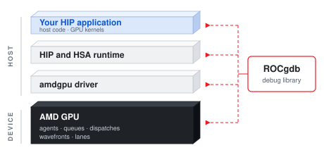

(index)=

<div class="rocgdb-hero-wrap">
<div class="rocgdb-hero">
<div class="rocgdb-hero-text">

<p class="rocgdb-eyebrow">AMD ROCm Debugger</p>

# Debug GPU code with ROCgdb

:::{div} rocgdb-hero-lead
ROCgdb is AMD's source-level debugger for Linux, based on the [GNU Debugger (GDB)](https://www.sourceware.org/gdb/documentation/). It debugs ROCm applications on x86 hosts with supported AMD GPUs.
:::

:::{div} rocgdb-hero-subtitle
Stop inside a HIP kernel, inspect a single lane, and find out why a session didn't behave as expected.
:::

:::{div} rocgdb-hero-actions
```{button-ref} rocgdb-first-hip-kernel
:color: primary
:class: sd-rounded-pill

Debug your first HIP kernel
```

```{button-ref} rocgdb-troubleshoot
:color: primary
:outline:
:class: sd-rounded-pill

Troubleshoot a problem
```
:::

</div>

<div class="rocgdb-hero-art">

:::{only} html
<a href="_static/rocgdb-architecture.svg" target="_blank" rel="noopener" title="Open the diagram in a new tab"></a>

ROCgdb reaches into every layer, from a host source line down to a single lane.
:::

</div>
</div>
</div>

## Where to start

If you have not installed ROCgdb yet, {ref}`do that first <rocgdb-installation>`.

:::::{grid} 1 2 2 4
:gutter: 3
:class-container: rocgdb-tiles

::::{grid-item-card}
:class-card: rocgdb-tile

:::{div} rocgdb-card-number
01
:::

**Start here**

Prepare a debug build and stop in your first kernel.

{ref}`Debug your first HIP kernel →<rocgdb-first-hip-kernel>`
::::

::::{grid-item-card}
:class-card: rocgdb-tile

:::{div} rocgdb-card-number
02
:::

**Understand GPU state**

Waves, lanes, and the commands that show them.

{ref}`GPU execution state →<rocgdb-gpu-execution-state>`
::::

::::{grid-item-card}
:class-card: rocgdb-tile

:::{div} rocgdb-card-number
03
:::

**Debug with other tools**

Third-party tools and Python.

{ref}`Third-party tools →<setting-third-party>`

{ref}`Debug Python applications →<debugging-python>`
::::

::::{grid-item-card}
:class-card: rocgdb-tile

:::{div} rocgdb-card-number
04
:::

**Troubleshoot**

Find the checks that match the symptom you saw.

{ref}`Troubleshoot a problem →<rocgdb-troubleshoot>`
::::
:::::

## What ROCgdb does

ROCgdb debugs both halves of a ROCm application in one session: the host code running on the CPU, and the kernels running on AMD GPUs. GPU wavefronts appear as threads next to the host threads, so you use the same GDB commands for both. With ROCgdb, you can do the following.

* **Stop inside a kernel.** Set breakpoints on a kernel or a source line, with conditions that ROCgdb checks for each lane. See {ref}`Debug your first HIP kernel <rocgdb-first-hip-kernel>`.
* **Inspect waves and lanes.** List waves with `info threads` and lanes with `info lanes`, switch between them with `thread` and `lane`, and print a value for every lane at once. See {ref}`GPU execution state <rocgdb-gpu-execution-state>`.
* **See what the GPU is running.** List GPUs, queues, and kernel launches with `info agents`, `info queues` and `info dispatches`. See [Debugging heterogeneous programs](https://rocm.docs.amd.com/projects/ROCgdb/en/latest/ROCgdb/gdb/doc/gdb/Heterogeneous-Debugging.html).
* **Catch errors where they happen.** `catch hiperr` stops when a HIP API call fails, and `set amdgpu precise-memory on` reports a GPU memory violation at the instruction that caused it. See [catch hiperr](https://rocm.docs.amd.com/projects/ROCgdb/en/latest/ROCgdb/gdb/doc/gdb/Set-Catchpoints.html#catch-hiperr) and [memory violation reporting](https://rocm.docs.amd.com/projects/ROCgdb/en/latest/ROCgdb/gdb/doc/gdb/AMD-GPU.html#AMD-GPU-Memory-Violation-Reporting).
* **Watch GPU memory.** Stop when a value changes, with up to four hardware write watchpoints. See {ref}`step 6 of Wrong results <rocgdb-wr-watch>`.
* **Attach to a running application.** Use `rocgdb -p` to look at an application that's already running. See {ref}`rocgdb-attach`.
* **Debug after a crash.** Open a core file that holds both CPU and GPU state. ROCgdb writes one with `gcore`, and the ROCm runtime writes one when a GPU fault crashes the application. See [AMD GPU core dumps](https://rocm.docs.amd.com/projects/ROCgdb/en/latest/ROCgdb/gdb/doc/gdb/AMD-GPU.html#AMD-GPU-core-dumps).
* **Use it from other tools.** Debug from an editor such as Visual Studio Code, or debug HIP kernels launched from Python. See [Setting up third-party tools](https://rocm.docs.amd.com/projects/ROCgdb/en/latest/how-to/third-party-tools.html) and {ref}`Debugging Python kernel code <debugging-python>`.

## Reference

::::{div} rocgdb-reference
**The ROCgdb user guide is the complete reference** for every command, the AMD GPU debugging model, and heterogeneous programs.

:::{div} rocgdb-reference-links
{ref}`Commands by task →<rocgdb-essential-commands>`

<p><a href="ROCgdb/gdb/doc/gdb/AMD-GPU.html">Debugging on AMD GPU →</a></p>

<p><a href="ROCgdb/gdb/doc/gdb/Heterogeneous-Debugging.html">Debugging heterogeneous programs →</a></p>

<p><a href="ROCgdb/gdb/doc/gdb/index.html">Full user guide →</a></p>
:::
::::

:::{div} rocgdb-footer-note
The ROCgdb code is open source and hosted at [ROCm/ROCgdb](https://github.com/ROCm/ROCgdb) on GitHub. For ROCgdb on Windows, see [AMD ROCm debugger for Windows](https://rocm.docs.amd.com/projects/install-on-windows/en/latest/how-to/debugger-windows.html).

To contribute to the documentation, refer to
[Contributing to ROCm](https://rocm.docs.amd.com/en/latest/contribute/contributing.html).

You can find licensing information on the [Licensing](https://rocm.docs.amd.com/en/latest/about/license.html) page.
:::
