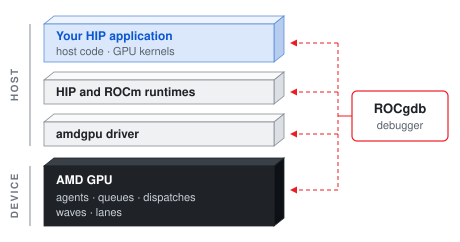

(index)=

<div class="rocgdb-hero-wrap">
<div class="rocgdb-hero">
<div class="rocgdb-hero-text">

<p class="rocgdb-eyebrow">AMD ROCm Debugger</p>

# Debug GPU code with ROCgdb

:::{div} rocgdb-hero-lead
The ROCm Debugger (ROCgdb) is a source-level debugger for Linux, based on the [GNU Debugger (GDB)](https://www.sourceware.org/gdb/documentation/). It debugs ROCm applications on x86 hosts with supported AMD GPUs.
:::

:::{div} rocgdb-hero-subtitle
Stop inside a HIP kernel, inspect a single lane, and find out why a session didn't behave as expected.
:::

:::{div} rocgdb-hero-actions
```{button-ref} rocgdb-first-hip-kernel
:color: primary
:class: sd-rounded-pill

Debug your first HIP kernel
```

```{button-ref} rocgdb-troubleshoot
:color: primary
:outline:
:class: sd-rounded-pill

Troubleshoot a problem
```
:::

</div>

<div class="rocgdb-hero-art">

:::{only} html
<a href="_static/rocgdb-architecture.svg" target="_blank" rel="noopener" title="Open the diagram in a new tab"></a>

ROCgdb reads state at every level, from a host source line down to a single lane on the GPU.
:::

</div>
</div>
</div>

## Where to start

ROCgdb is installed with ROCm, and you start it with the `rocgdb` command. If you haven't installed it yet, {ref}`do that first <rocgdb-installation>`. On Windows, use the separately released [AMD ROCm debugger for Windows](https://rocm.docs.amd.com/projects/install-on-windows/en/latest/how-to/debugger-windows.html).

:::::{grid} 1 2 2 4
:gutter: 3
:class-container: rocgdb-tiles

::::{grid-item-card}
:class-card: rocgdb-tile

:::{div} rocgdb-card-number
01
:::

**Start here**

Prepare a debug build, stop in your first kernel, and learn what ROCgdb shows.

{ref}`Debug your first HIP kernel →<rocgdb-first-hip-kernel>`

{ref}`GPU execution state →<rocgdb-gpu-execution-state>`
::::

::::{grid-item-card}
:class-card: rocgdb-tile

:::{div} rocgdb-card-number
02
:::

**Debug tasks**

Track down a wrong result, or attach to an application that's already running.

{ref}`Wrong results or unexpected values →<rocgdb-troubleshoot-wrong-results>`

{ref}`Attach to a running process →<rocgdb-attach>`
::::

::::{grid-item-card}
:class-card: rocgdb-tile

:::{div} rocgdb-card-number
03
:::

**Debug with other tools**

Debug from an editor such as Visual Studio Code, or debug HIP kernels launched from Python.

{ref}`Set up third-party tools →<setting-third-party>`

{ref}`Debug Python kernel code →<debugging-python>`
::::

::::{grid-item-card}
:class-card: rocgdb-tile

:::{div} rocgdb-card-number
04
:::

**Troubleshoot**

Start from the symptom you saw, not a command name.

{ref}`Troubleshoot a problem →<rocgdb-troubleshoot>`

{ref}`Kernel breakpoint isn't hit →<rocgdb-troubleshoot-breakpoint-not-hit>`
::::
:::::

## What ROCgdb does

ROCgdb debugs both halves of a ROCm application in one session: the host code running on the CPU, and the kernels running on AMD GPUs. GPU waves appear as threads next to the host threads, so you use the same GDB commands for both. With ROCgdb, you can do the following.

* **Stop inside a kernel.** Set breakpoints on a kernel or a source line, with conditions that ROCgdb checks for each lane. See {ref}`Debug your first HIP kernel <rocgdb-first-hip-kernel>`.
* **Inspect waves and lanes.** List waves with `info threads` and lanes with `info lanes`, switch between them with `thread` and `lane`, and print a value for every lane at once. See {ref}`GPU execution state <rocgdb-gpu-execution-state>`.
* **See what the GPU is running.** List GPUs, queues, and kernel launches with `info agents`, `info queues`, and `info dispatches`. See [Debugging heterogeneous programs](https://rocm.docs.amd.com/projects/ROCgdb/en/latest/ROCgdb/gdb/doc/gdb/Heterogeneous-Debugging.html).
* **Catch errors where they happen.** `catch hiperr` stops when a HIP API call fails, and `set amdgpu precise-memory on` reports a GPU memory violation at the instruction that caused it. See [catch hiperr](https://rocm.docs.amd.com/projects/ROCgdb/en/latest/ROCgdb/gdb/doc/gdb/Set-Catchpoints.html#catch-hiperr) and [memory violation reporting](https://rocm.docs.amd.com/projects/ROCgdb/en/latest/ROCgdb/gdb/doc/gdb/AMD-GPU.html#AMD-GPU-Memory-Violation-Reporting).
* **Watch GPU memory.** Stop when a value changes, with up to four hardware write watchpoints. See {ref}`step 6 of Wrong results <rocgdb-wr-watch>`.
* **Attach to a running application.** Use `rocgdb -p` to look at an application that's already running. See {ref}`rocgdb-attach`.
* **Debug after a crash.** Open a core file that holds both CPU and GPU state. ROCgdb writes one with `gcore`, and the ROCm runtime writes one when a GPU fault crashes the application. See [AMD GPU core dumps](https://rocm.docs.amd.com/projects/ROCgdb/en/latest/ROCgdb/gdb/doc/gdb/AMD-GPU.html#AMD-GPU-core-dumps).
* **Use it from other tools.** Debug from an editor such as Visual Studio Code, or debug HIP kernels launched from Python. See {ref}`Set up third-party tools <setting-third-party>` and {ref}`Debug Python kernel code <debugging-python>`.

## Reference

::::{div} rocgdb-reference
**The ROCgdb user guide is the complete reference** for every command, the AMD GPU debugging model, and heterogeneous programs.

:::{div} rocgdb-reference-links
{ref}`Commands by task →<rocgdb-essential-commands>`

{ref}`Known limitations and compatibility →<rocgdb-known-limitations>`
:::

:::{div} rocgdb-reference-links
<p><a href="ROCgdb/gdb/doc/gdb/AMD-GPU.html">Debugging on AMD GPU →</a></p>

<p><a href="ROCgdb/gdb/doc/gdb/Heterogeneous-Debugging.html">Debugging heterogeneous programs →</a></p>

<p><a href="ROCgdb/gdb/doc/gdb/index.html">Full user guide →</a></p>
:::
::::

:::{div} rocgdb-footer-note
ROCgdb is open source: [ROCm/ROCgdb](https://github.com/ROCm/ROCgdb) on GitHub · [Contributing to ROCm](https://rocm.docs.amd.com/en/latest/contribute/contributing.html) · [Licensing](https://rocm.docs.amd.com/en/latest/about/license.html)
:::
