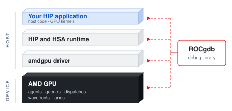

(index)=

<div class="rocgdb-hero-wrap">
<div class="rocgdb-hero">
<div class="rocgdb-hero-text">

<p class="rocgdb-eyebrow">AMD ROCm Debugger</p>

# Debug GPU code with ROCgdb

:::{div} rocgdb-hero-subtitle
Stop inside a HIP kernel, inspect a single lane, and find out why a session didn't behave as expected.
:::

:::{div} rocgdb-hero-actions
```{button-ref} rocgdb-first-hip-kernel
:color: primary
:class: sd-rounded-pill

Debug your first HIP kernel
```

```{button-ref} rocgdb-troubleshoot
:color: primary
:outline:
:class: sd-rounded-pill

Troubleshoot a problem
```
:::

</div>

<div class="rocgdb-hero-art">

:::{only} html
<a href="_static/rocgdb-architecture.svg" target="_blank" rel="noopener" title="Open the diagram in a new tab"></a>

ROCgdb reads state at every level, from a host source line down to a single lane on the GPU.
:::

</div>
</div>
</div>

ROCgdb is the AMD source-level debugger for Linux, based on the [GNU Debugger (GDB)](https://www.sourceware.org/gdb/documentation/). It debugs ROCm applications on x86 hosts with supported AMD GPUs. You can set breakpoints, step through code, and inspect memory and variables in the host and GPU code of the same {doc}`HIP <hip:index>` application. ROCgdb uses the {doc}`AMD Debugger API Library (ROCdbgapi) <rocdbgapi:index>`, which is included with ROCm.

For ROCgdb on Windows, see [AMD ROCm debugger for Windows](https://rocm.docs.amd.com/projects/install-on-windows/en/latest/how-to/debugger-windows.html).

The code is open source and hosted at: <https://github.com/ROCm/ROCgdb>

## Where to start

:::::{grid} 1 2 2 4
:gutter: 3
:class-container: rocgdb-tiles

::::{grid-item-card}
:class-card: rocgdb-tile

:::{div} rocgdb-card-number
01
:::

**Start here**

Prepare a debug build and stop in your first kernel.

{ref}`Debug your first HIP kernel →<rocgdb-first-hip-kernel>`

{ref}`Install ROCgdb →<rocgdb-installation>`
::::

::::{grid-item-card}
:class-card: rocgdb-tile

:::{div} rocgdb-card-number
02
:::

**Understand GPU state**

Waves, lanes, and the commands that show them.

{ref}`GPU execution state →<rocgdb-gpu-execution-state>`
::::

::::{grid-item-card}
:class-card: rocgdb-tile

:::{div} rocgdb-card-number
03
:::

**Development environments**

Third-party tools and Python.

{ref}`Third-party tools →<setting-third-party>`

{ref}`Debug Python applications →<debugging-python>`
::::

::::{grid-item-card}
:class-card: rocgdb-tile

:::{div} rocgdb-card-number
04
:::

**Troubleshoot**

Start from the symptom you saw, not a command name.

{ref}`Pick your symptom →<rocgdb-troubleshoot>`
::::
:::::

## Reference

::::{div} rocgdb-reference
**The ROCgdb user guide is the complete reference** for every command, the AMD GPU debugging model, and heterogeneous programs.

:::{div} rocgdb-reference-links
{ref}`Commands by task →<rocgdb-essential-commands>`

<p><a href="ROCgdb/gdb/doc/gdb/AMD-GPU.html">Debugging on AMD GPU →</a></p>

<p><a href="ROCgdb/gdb/doc/gdb/Heterogeneous-Debugging.html">Debugging heterogeneous programs →</a></p>

<p><a href="ROCgdb/gdb/doc/gdb/index.html">Full user guide →</a></p>
:::
::::

:::{div} rocgdb-footer-note
To contribute to the documentation, refer to
[Contributing to ROCm](https://rocm.docs.amd.com/en/latest/contribute/contributing.html).

You can find licensing information on the [Licensing](https://rocm.docs.amd.com/en/latest/about/license.html) page.
:::
