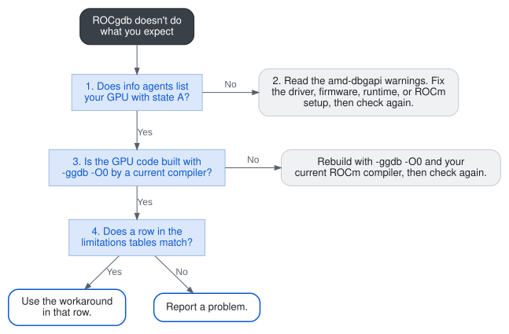
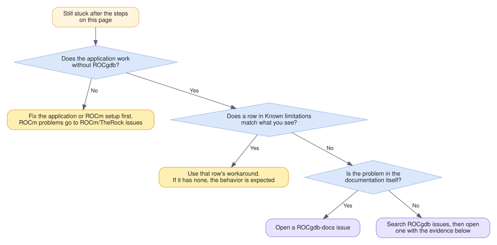

---
myst:
  html_meta:
    "description lang=en": "Check whether ROCgdb supports your GPU and setup, read amd-dbgapi startup warnings, and find known limitations and workarounds before you spend time debugging."
    "keywords": "ROCgdb known limitations, supported GPUs, amd-dbgapi warning, watchpoints, attach, core dump, workaround"
---

% TODO(engineering validation): Items still open from the 10.2 review.
% - Workarounds not stated in the manual: gdbserver, thousands of waves at one
%   breakpoint, read and access watchpoints, function calls in GPU code,
%   sanitizers, runtime core dumps while attached, OpenMP. Confirm with the
%   ROCgdb team.
% - SR-IOV: confirm whether whole-GPU passthrough to a VM is supported, and
%   whether runtime GPU core dumps while attached are fixed for 10.2.
% - The gfx1153 product name, and all product names against the published LLVM
%   AMDGPU processors table and the ROCm compatibility matrix. gfx1250 and
%   gfx1170 to gfx1172 stay without names until those are public.
% - The limitations come from the AMD GPU Restrictions section of
%   gdb/doc/gdb/gdb.texinfo on amd-staging (commit c4f4140, checked 10 November
%   2026). Recheck before publication.
% - Product names to settle with the product owners: gfx1153 (LLVM says TBA,
%   the TheRock target list says Radeon 820M, the ROCm 10.1 compatibility matrix
%   says Radeon 840M) and gfx1032 (Radeon RX 6600 appears only in the TheRock
%   list; LLVM says TBA and the matrix does not list it).
% - Compiler-bug routing on the wrong-results page (ROCm/llvm-project for
%   AMD-specific problems, upstream LLVM otherwise) needs the compiler team to
%   confirm it is their process.

(rocgdb-known-limitations)=

# Known limitations and compatibility

Find out whether ROCgdb supports your GPU and setup, and whether what you're trying to do is a known limitation, before you spend time on it.

## When to use this page

Use this page when:

* ROCgdb starts, but you never see an `AMDGPU Wave` in `info threads`.
* ROCgdb prints a warning that starts with `amd-dbgapi`.
* A feature such as a watchpoint, a function call, attaching, or a core dump doesn't behave the way it does in CPU code.

If you haven't stopped in a kernel before, start with {ref}`Debug your first HIP kernel <rocgdb-first-hip-kernel>`.

## Prerequisites

* ROCgdb is installed and on your `PATH`. See {ref}`Install ROCm Debugger (ROCgdb) <rocgdb-installation>`.
* The application runs correctly without the debugger.

## How the checks fit together

<a href="../_static/rocgdb-known-limitations-checks.svg" target="_blank" rel="noopener" title="Open the diagram in a new tab"></a>

(rocgdb-kl-check-gpu)=

## 1. Check that ROCgdb can see your GPU

Start the application under ROCgdb, stop at the start of `main`, and list the GPUs. You can also use `starti` to stop at the first instruction. Before `run`, `info agents` prints `No agents are currently active`.

```shell
$ rocgdb ./saxpy
(gdb) break main
(gdb) run
(gdb) info agents
```

Output captured on an AMD Instinct MI210 (gfx90a). Your GPUs and IDs differ:

```text
  Id State Target Id                  Architecture Device Name        Cores Threads Location
  1  A     AMDGPU Agent (GPUID 35090) gfx90a       AMD Instinct MI210 416   3328    0000:4a:00.0
```

Other GPUs show the same columns, for example `gfx1100` and `AMD Radeon Pro W7900`, or `gfx1201` and `AMD Radeon RX 9070 XT`. No row is marked `*` at a host breakpoint. The `*` appears only once a GPU thread is current.

**Expected result:** Every GPU you plan to debug is listed with `A` (active) in the **State** column.

:::{admonition} If this fails

* **The GPU shows `U`.** ROCgdb can't debug it. Find its **Architecture** value in [supported architectures](https://rocm.docs.amd.com/projects/ROCgdb/en/latest/ROCgdb/gdb/doc/gdb/AMD-GPU.html#AMD-GPU-Architectures). If it isn't listed, there's no workaround on that GPU. If it's listed, the driver or firmware is the problem: go to {ref}`step 2 <rocgdb-kl-warnings>`.
* **No GPUs are listed, or the program exits before the breakpoint.** The application can't see a GPU. Run `rocminfo` outside ROCgdb. If it lists no `gfx` agent, fix the ROCm installation first. See {ref}`Install ROCm <rocgdb-installation>`. If `rocminfo` lists the GPU, check that `ROCR_VISIBLE_DEVICES` and `HIP_VISIBLE_DEVICES` aren't set to hide it. In a container, check the device mapping in the limitations table in {ref}`step 4 <rocgdb-kl-limitations>`.
:::

(rocgdb-kl-warnings)=

## 2. Read the startup warnings

When ROCgdb can't debug a GPU, it prints a warning and keeps running, so you might miss it. Scroll back to where you typed `run` and look for lines that start with `amd-dbgapi` or `amd_dbgapi`. Find the line in this table that matches.

```{list-table}
:header-rows: 1

* - The warning contains
  - What it means
  - What to do
* - `AMD GPU driver's version ... not supported`

    `AMD GPU driver's debug support version ... not supported`
  - The kernel driver's version is outside the range this ROCgdb supports, either too old or too new. No GPU can be debugged.
  - Install a driver supported by your ROCm release (see the [ROCm compatibility matrix](https://rocm.docs.amd.com/en/latest/compatibility/compatibility-matrix.html)), reboot, and repeat {ref}`step 1 <rocgdb-kl-check-gpu>`. To check the loaded driver version, run `amd-smi version` or `cat /sys/module/amdgpu/version`. `modinfo amdgpu` shows the installed driver file, which can differ from the loaded one until you reboot.
* - `AMD GPU gpu_id NNNNN's firmware version ... not supported`
  - The driver reports that the firmware loaded on that one GPU doesn't support debugging. Only that GPU is excluded. Other GPUs can still be debugged.
  - Update the driver packages (or `linux-firmware`), reboot, and repeat {ref}`step 1 <rocgdb-kl-check-gpu>`. To check the firmware versions, run `amd-smi firmware`.
* - `AMD GPU runtime's r_debug::r_version ... not supported`
  - The application loaded a ROCm runtime whose version is outside the range this ROCgdb supports. This usually means it loaded a different ROCm installation from ROCgdb's, for example a runtime bundled with the application, as some Python wheels do.
  - Run `ldd ./saxpy | grep hsa-runtime` to see which HSA runtime the application loads. Run the application against the same ROCm installation that ROCgdb came from. If the application needs a newer runtime than this ROCgdb supports, update ROCgdb.
* - `At least one agent is busy (debugging may be enabled by another process)`
  - Another process on this GPU is already being debugged. Some GPUs, such as gfx908, allow only one.
  - End the other debugging session, or give each session its own GPUs (see the container row in {ref}`step 4 <rocgdb-kl-limitations>`).
```

These messages are described in [Device driver and ROCm runtime](https://rocm.docs.amd.com/projects/ROCgdb/en/latest/ROCgdb/gdb/doc/gdb/AMD-GPU.html#AMD-GPU-Device-Driver-and-AMD-ROCm-Runtime).

**Expected result:** A new session prints no `amd-dbgapi` warnings, and `info agents` shows your GPU with state `A`.

(rocgdb-kl-build)=

## 3. Check the build

ROCgdb needs debug information for the GPU code. It also reads only Code Object V3 or later, which is what the ROCm compiler produces by default. Build the way {ref}`Debug your first HIP kernel <rocgdb-first-hip-kernel-build>` does:

```shell
$ amdclang++ -ggdb -O0 -x hip --offload-arch=native -I../../Common main.hip -o saxpy
```

**Expected result:** The binary runs, and ROCgdb loads it without errors about the code object.

:::{admonition} If this fails

If ROCgdb reports `ELF file ABI version (0) is not supported`, the GPU code is older than Code Object V3. Rebuild it with your current ROCm compiler, and remove any option that selects an older code object version.
:::

(rocgdb-kl-limitations)=

## 4. Check the known limitations

These limitations apply to ROCgdb in ROCm 10.2. Find the row that matches what you're trying to do. The tables cover the common ones. The full list is in [AMD GPU restrictions](https://rocm.docs.amd.com/projects/ROCgdb/en/latest/ROCgdb/gdb/doc/gdb/AMD-GPU.html#AMD-GPU-Restrictions) in the manual. Last checked against the manual on the ROCgdb `amd-staging` branch, commit `c4f4140`.

The **Status** column uses three values:

* **Not supported**: doesn't work, with or without a workaround.
* **Limited**: works with restrictions.
* **Needs setup**: works once you change a setting.

(rocgdb-kl-container)=

### Setup and environment

```{list-table}
:header-rows: 1

* - What you're trying to do
  - Status
  - What to do instead
* - Debug inside a Docker container
  - Needs setup
  - Map `/dev/kfd` and the GPU's `/dev/dri/renderD<N>` into the container, add the user to the `render` group (Ubuntu) or `video` group (other distributions), and pass `--cap-add=SYS_PTRACE --security-opt seccomp=unconfined`. [Example command](https://rocm.docs.amd.com/projects/ROCgdb/en/latest/ROCgdb/gdb/doc/gdb/AMD-GPU.html#AMD-GPU-Restrictions).
* - Debug two applications on the same GPU at the same time
  - Limited
  - On some GPUs, such as gfx908, only one debugged process can use a GPU. Run each session in its own container with a different set of GPUs. One ROCgdb session can't debug two GPU applications at once.
* - Debug several programs that use the GPU in one ROCgdb session
  - Limited
  - When ROCgdb halts GPU waves in one program, the other programs might not be able to run GPU waves.
* - Debug remotely with `gdbserver`
  - Not supported
  - Run ROCgdb on the machine that has the GPU, for example in an SSH session.
* - Debug on a GPU shared through Single Root I/O Virtualization (SR-IOV), including gfx1030, gfx1031, and gfx1032
  - Not supported
  - No workaround. Debug on a system where the GPU isn't shared through SR-IOV.
```

### Breakpoints, stepping, and watchpoints

```{list-table}
:header-rows: 1

* - What you're trying to do
  - Status
  - What to do instead
* - Set a breakpoint in a kernel before the kernel has launched
  - Needs setup
  - Run `set breakpoint pending on`, then set the breakpoint by kernel name, not by source line. Or start ROCgdb with `HIP_ENABLE_DEFERRED_LOADING=0`. See {ref}`Kernel breakpoint isn't hit <rocgdb-troubleshoot-breakpoint-not-hit>`.
* - Continue quickly when thousands of waves hit the same breakpoint
  - Limited
  - Make fewer waves stop with a condition, such as `break saxpy_kernel if blockIdx.x == 0`, or use `break -lane 0 saxpy_kernel` with `set scheduler-locking on`. `tbreak` reduces the number of hits ROCgdb reports, not the number of waves that halt: many waves can still stop at the breakpoint address, and ROCgdb continues them when you resume. See [breakpoints on heterogeneous lanes](https://rocm.docs.amd.com/projects/ROCgdb/en/latest/ROCgdb/gdb/doc/gdb/Heterogeneous-Debugging.html#break-commands).
* - Set more than four GPU watchpoints, or watch reads (`rwatch`, `awatch`)
  - Limited
  - Use at most four `watch` (write) watchpoints with a combined size of 32 bytes or less. Each watchpoint's size counts as rounded up to a multiple of 8 bytes. Beyond that, ROCgdb falls back to software watchpoints, which are very slow. `rwatch` and `awatch` are accepted, but `continue` then fails with `Could not insert hardware watchpoint … too many hardware breakpoints/watchpoints`. To catch a read, put a conditional breakpoint on the line that reads the value. This only helps if you know which lines read it.
* - Catch every write to a location with a watchpoint
  - Limited
  - Watchpoints reach the GPU only after the ROCm runtime starts. Set them after your first kernel breakpoint, and set them again after `run` restarts the program. Writes by `hipMemcpy` use direct memory access (DMA) and aren't seen: start ROCgdb with `HSA_ENABLE_SDMA=0`. On gfx10, gfx11, and gfx12 GPUs, a write by a kernel's last instruction can be missed: run `set amdgpu precise-memory on` before `run`.
* - Single-step a wave when ROCgdb seems to wait forever
  - Limited
  - Press Ctrl-C to cancel the step, then run it again.
* - Interrupt with Ctrl-C after resuming only a GPU wave with `set scheduler-locking on`
  - Not supported
  - Ctrl-C can't stop GPU waves when no CPU thread is running. Before you resume only a GPU wave, make sure a breakpoint will stop it. If ROCgdb is already stuck, end the `rocgdb` process.
* - Put a breakpoint inside an `s_clause` on gfx10, gfx11, or gfx12
  - Not supported
  - Put the breakpoint before or after the clause. You can step through a clause.
* - Continue a wave without delivering its signal, such as `signal 0` after a `SIGSEGV`
  - Limited
  - On some GPUs, the ROCm runtime can still put the queue into an error state. Suppressing `SIGSEGV` can also hide the same signal raised by DMA or the packet processor, so the runtime isn't told about it. See [AMD GPU signals](https://rocm.docs.amd.com/projects/ROCgdb/en/latest/ROCgdb/gdb/doc/gdb/AMD-GPU.html#AMD-GPU-Signals).
* - Single-step or continue from an illegal instruction
  - Limited
  - What happens next in ROCgdb can differ from what happens on the GPU without the debugger.
* - Insert a breakpoint or change memory in non-stop mode while waves are running
  - Limited
  - A running wave might not hit the breakpoint, or see the memory change, until it next stops. Memory that running waves write might not be visible until they stop.
```

### Inspecting values

```{list-table}
:header-rows: 1

* - What you're trying to do
  - Status
  - What to do instead
* - Print variables in optimized code (`-O1` and higher)
  - Limited
  - Rebuild with `-ggdb -O0`. Above `-O0`, the compiler doesn't always describe where variables are.
* - Print a `__shared__` variable by name
  - Not supported
  - No workaround. The compiler reports these variables at address `0x0` in the local address space, so their values are wrong.
* - Call a function from the debugger, such as `print f(x)` or `call f(x)`, in GPU code
  - Not supported
  - ROCgdb reports `This target does not support function calls.` Print the function's inputs and work out the result yourself, or temporarily store the result in a local variable in the kernel and print that.
* - See where an inactive lane will run next
  - Limited
  - Inactive lanes always show the wave's current location. Run `info lanes` to see which lanes are active (`A`) and which aren't (`I`), and select an active lane.
* - See a file path for GPU code instead of `memory://`
  - Needs setup
  - Start ROCgdb with `HSA_LOADER_ENABLE_MMAP_URI=1`.
* - Convert an integer to a pointer in an expression, such as `print *(int *)0x...`
  - Limited
  - ROCgdb uses the top 8 bits of an address for its address space, so those bits of the integer are set to zero. The same happens to a large value used with the `#` address space qualifier.
```

### Attaching and core dumps

```{list-table}
:header-rows: 1

* - What you're trying to do
  - Status
  - What to do instead
* - See the work-group of waves that started before you attached
  - Needs setup
  - Start the application with `HSA_ENABLE_DEBUG=1`. Without it, some GPUs show `?` in those waves' IDs, and that can't be fixed after the application has started. See {ref}`rocgdb-attach`.
* - Debug an application that uses cooperative groups or compute unit (CU) masking on gfx1100, gfx1101, or gfx1102
  - Not supported
  - No workaround on these GPUs. While ROCgdb is attached, creating a cooperative or CU-masked queue fails.
* - Get a GPU core dump from the ROCm runtime while ROCgdb is attached
  - Not supported
  - Run `gcore` in ROCgdb when the application stops. ROCgdb writes a core file with both CPU and GPU state.
* - Get a GPU core dump from the ROCm runtime on gfx1100, gfx1101, or gfx1102
  - Not supported
  - Run the application under ROCgdb and use `gcore` when it stops.
* - Get a GPU core dump when the crash is in host code
  - Not supported
  - Only the host core file is written. Open it in ROCgdb as a normal core file. See [AMD GPU core dumps](https://rocm.docs.amd.com/projects/ROCgdb/en/latest/ROCgdb/gdb/doc/gdb/AMD-GPU.html#AMD-GPU-core-dumps).
```

### Languages and tools

```{list-table}
:header-rows: 1

* - What you're trying to do
  - Status
  - What to do instead
* - Debug Fortran or OpenCL kernels
  - Limited
  - Breakpoints, stepping, registers and memory work, but values aren't printed with language-aware formatting. Compile with Code Object V3 or later and DWARF 4. See [source languages](https://rocm.docs.amd.com/projects/ROCgdb/en/latest/ROCgdb/gdb/doc/gdb/AMD-GPU.html#AMD-ROCm-Source-Languages).
* - Use OpenMP language features while debugging C, C++ or Fortran
  - Not supported
  - OpenMP target regions can be debugged as ordinary GPU kernels. ROCgdb has no OpenMP-specific view, kernel names are compiler-generated (`__omp_offloading_…`), and OpenMP internals such as `.omp.iv` show up in `info locals`.
* - Debug a build that uses the address, memory or thread sanitizer on the GPU
  - Not supported
  - Debug a build without `-fsanitize`, and run the sanitizer build outside ROCgdb.
```

A few rarer restrictions, such as `DX10_CLAMP` and arithmetic exceptions, and code after `s_sendmsg sendmsg(MSG_DEALLOC_VGPRS)`, are listed in [AMD GPU restrictions](https://rocm.docs.amd.com/projects/ROCgdb/en/latest/ROCgdb/gdb/doc/gdb/AMD-GPU.html#AMD-GPU-Restrictions).

(rocgdb-kl-supported)=

## Supported hosts, GPUs, and languages

This section lists the host operating system, GPU architectures, and source languages that ROCgdb supports.

### Host

Linux on x86-64. ROCgdb for Windows is released separately, with its own documentation and support matrix; see [AMD ROCm debugger for Windows](https://rocm.docs.amd.com/projects/install-on-windows/en/latest/how-to/debugger-windows.html).

### GPU architectures

```{list-table}
:header-rows: 1

* - Family
  - Architectures
* - gfx9
  - gfx900 (Vega 10), gfx906 (Vega 7nm), gfx908 (AMD Instinct MI100), gfx90a (AMD Instinct MI200 Series), gfx942 (AMD Instinct MI300X, MI300A), gfx950 (AMD Instinct MI350X, MI355X)
* - gfx10
  - gfx1010, gfx1011, gfx1012, gfx1030, gfx1031, gfx1032
* - gfx11
  - gfx1100 (Radeon PRO W7900, Radeon RX 7900 XTX and XT), gfx1101 (Radeon RX 7800 XT, 7700 XT), gfx1102 (Radeon RX 7600), gfx1150 (Radeon 890M), gfx1151 (Radeon 8060S), gfx1153, gfx1170, gfx1171, gfx1172
* - gfx12
  - gfx1200 (Radeon RX 9060), gfx1201 (Radeon RX 9070, 9070 XT), gfx1250, gfx1250-strict
* - Generic targets
  - gfx9-generic, gfx9-4-generic, gfx10-1-generic, gfx10-3-generic, gfx11-generic, gfx11-7-generic, gfx12-generic, gfx12-5-generic
```

Example products are from LLVM's [AMDGPU processors table](https://llvm.org/docs/AMDGPUUsage.html#processors), which lists more. On your system, `info agents` shows the product name in the **Device Name** column. Some features don't work on every architecture. See {ref}`step 4 <rocgdb-kl-limitations>`, and the [architectures list in the manual](https://rocm.docs.amd.com/projects/ROCgdb/en/latest/ROCgdb/gdb/doc/gdb/AMD-GPU.html#AMD-GPU-Architectures).

### Source languages

```{list-table}
:header-rows: 1

* - Language
  - Support
* - HIP
  - Supported. Work-items map to lanes in a wave.
* - Assembly
  - Assembly code kernels are supported.
* - OpenCL, Fortran, and others
  - Breakpoints, stepping, registers and memory work, but values aren't printed with language-aware formatting. The code must be built for Code Object V3 or later with DWARF 4 debug information.
```

See [source languages](https://rocm.docs.amd.com/projects/ROCgdb/en/latest/ROCgdb/gdb/doc/gdb/AMD-GPU.html#AMD-ROCm-Source-Languages) in the manual.

## Interpret what you see

```{list-table}
:header-rows: 1

* - What you see
  - What it means
  - What to do
  - Read more
* - `info agents` shows `U` for a GPU
  - ROCgdb can't debug that GPU.
  - Check its architecture, then the warnings ({ref}`steps 1 and 2 <rocgdb-kl-check-gpu>`).
  - [info agents in the manual](https://rocm.docs.amd.com/projects/ROCgdb/en/latest/ROCgdb/gdb/doc/gdb/Heterogeneous-Debugging.html)
* - No `AMDGPU Wave` ever appears in `info threads`
  - No GPU is visible, or no kernel launched.
  - {ref}`Step 1 <rocgdb-kl-check-gpu>`, then {ref}`confirm the kernel launches <rocgdb-bp-check-launch>`.
  - {ref}`Waves are threads <rocgdb-waves-are-threads>`
* - A line starting with `amd-dbgapi: warning`
  - Driver, firmware, or runtime mismatch.
  - Use the table in {ref}`step 2 <rocgdb-kl-warnings>`.
  - [Device driver and ROCm runtime](https://rocm.docs.amd.com/projects/ROCgdb/en/latest/ROCgdb/gdb/doc/gdb/AMD-GPU.html#AMD-GPU-Device-Driver-and-AMD-ROCm-Runtime)
* - `ELF file ABI version (0) is not supported`
  - The GPU code is older than Code Object V3.
  - Rebuild ({ref}`step 3 <rocgdb-kl-build>`).
  - [AMD GPU restrictions](https://rocm.docs.amd.com/projects/ROCgdb/en/latest/ROCgdb/gdb/doc/gdb/AMD-GPU.html#AMD-GPU-Restrictions)
* - A variable prints as `<optimized out>`
  - The build is optimized.
  - Rebuild with `-ggdb -O0`.
  - {ref}`Compile with debug information <rocgdb-first-hip-kernel-build>`
* - `continue` is very slow after you add a watchpoint
  - The watchpoints went over the hardware limit, so ROCgdb fell back to software.
  - Delete watchpoints until four or fewer are left, with a combined size of 32 bytes or less.
  - [Setting watchpoints](https://rocm.docs.amd.com/projects/ROCgdb/en/latest/ROCgdb/gdb/doc/gdb/Set-Watchpoints.html)
* - `Couldn't get registers: No such process.`
  - The application exited while ROCgdb was still handling a wave's breakpoint.
  - Nothing to fix. Run again if you need that stop.
  - [AMD GPU restrictions](https://rocm.docs.amd.com/projects/ROCgdb/en/latest/ROCgdb/gdb/doc/gdb/AMD-GPU.html#AMD-GPU-Restrictions)
```

(rocgdb-kl-report)=

## Report a problem

If your problem isn't explained by the preceding steps or tables, work out where to send it:

<a href="../_static/rocgdb-known-limitations-report.svg" target="_blank" rel="noopener" title="Open the diagram in a new tab"></a>

Where to send it:

* ROCgdb problems: [ROCm/ROCgdb issues](https://github.com/ROCm/ROCgdb/issues)
* Wrong or unclear documentation: [ROCm/ROCgdb-docs issues](https://github.com/ROCm/ROCgdb-docs/issues)
* ROCm installation, driver, or runtime problems: [ROCm/TheRock issues](https://github.com/ROCm/TheRock/issues)

To open a ROCgdb issue:

1. **Search first.** Search [ROCgdb issues](https://github.com/ROCm/ROCgdb/issues) for the exact warning or error text. If someone has already reported it, add a thumbs-up and a comment with your evidence rather than opening a new issue. This is the [ROCm feedback guidance](https://rocm.docs.amd.com/en/latest/contribute/feedback.html).
2. **Collect the evidence** in the box below.
3. **Open the issue** with a title like *Watchpoint doesn't trigger on gfx942, ROCm 10.2*, and paste the template below into the description.
4. **Watch the issue.** Engineers might ask you to try something, so check back for questions.

:::{admonition} Evidence to collect

Outside ROCgdb:

```shell
$ rocgdb --version
$ rocminfo | grep gfx
$ uname -r
$ grep PRETTY_NAME /etc/os-release
```

Record the whole session to a file so nothing gets lost:

```shell
$ rocgdb -ex "set logging file rocgdb.log" -ex "set logging enabled on" ./saxpy
```

In that session, run `show configuration` and `info agents`, then reproduce the problem. Attach `rocgdb.log` to the issue.
:::

Issue template:

```text
What I was trying to do:
What I expected:
What happened (paste output, including any amd-dbgapi warnings):
Does the application work without ROCgdb? yes / no
Compile command:
rocgdb --version:
GPU (rocminfo | grep gfx):
OS and kernel:
Log attached: rocgdb.log
```

## You are done when

ROCgdb shows your GPU as active with no startup warnings, and you've either found the limitation that explains what you see and used its workaround, or opened an issue with the evidence.

## Related information

* {ref}`Debug your first HIP kernel <rocgdb-first-hip-kernel>`
* {ref}`Kernel breakpoint isn't hit <rocgdb-troubleshoot-breakpoint-not-hit>`
* [ROCm compatibility matrix](https://rocm.docs.amd.com/en/latest/compatibility/compatibility-matrix.html)
* [AMD GPU restrictions](https://rocm.docs.amd.com/projects/ROCgdb/en/latest/ROCgdb/gdb/doc/gdb/AMD-GPU.html#AMD-GPU-Restrictions) (full list in the manual)
