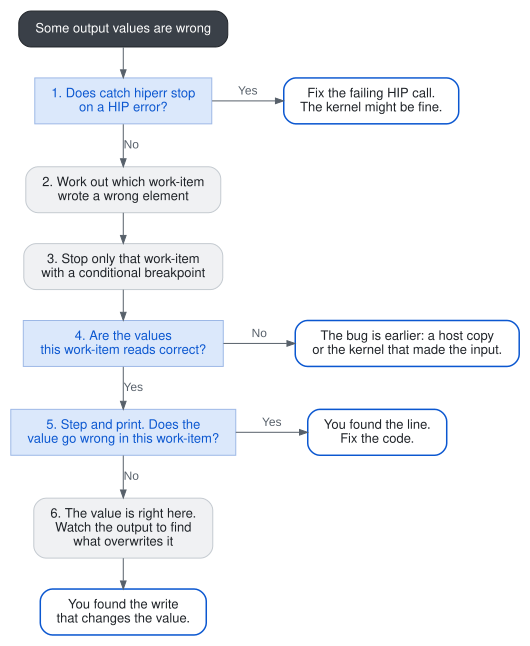
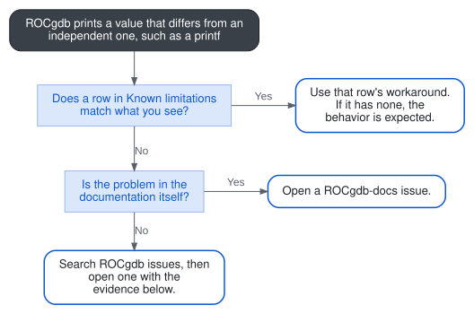

---
myst:
  html_meta:
    "description lang=en": "Find the work-item that computes a wrong value in a HIP kernel, stop only that work-item, and find the line or write that makes the value wrong, with ROCgdb."
    "keywords": "ROCgdb wrong results, conditional breakpoint, blockIdx, threadIdx, watch, catch hiperr, wrong output"
---

% TODO(engineering validation): Items still open from the 10.2 review.
% - Step 6: confirm that `watch -location d_y[global_idx]`, set from a GPU
%   stop, catches a later write by another wave or kernel on gfx9 and on
%   gfx11 or gfx12 (confirmed once, for another kernel and another wave).
% - Interpret table: confirm where to send compiler problems that appear only
%   in optimized builds (ROCm/llvm-project or upstream LLVM) with the
%   compiler team.
% - The breakpoint hit message in step 3 was captured on gfx90a (MI210). The
%   lane is the thread index modulo the wave size.
% - Captures requested from Luis on 10 November 2026 and still open: step 4
%   (the `next` then `print` sequence: confirm one `next` is enough for
%   `global_idx` to be set, and that the values 1000, 2, 1001 and 1 are real;
%   they were worked out from the code) and step 6 (the watchpoint stop
%   message, with the old value, new value and writing line, has no sample).

(rocgdb-troubleshoot-wrong-results)=

# Wrong results or unexpected values

Find the work-item that computes a wrong value, stop only that work-item, and find the line where its value goes wrong.

## When to use this page

Use this page when your kernel runs to completion but some output values are wrong, or when a value you print in ROCgdb isn't what you expect.

* If the kernel never stops at your breakpoint, see {ref}`Kernel breakpoint isn't hit <rocgdb-troubleshoot-breakpoint-not-hit>`.
* If the application crashes with a memory access fault, see [memory violation reporting](https://rocm.docs.amd.com/projects/ROCgdb/en/latest/ROCgdb/gdb/doc/gdb/AMD-GPU.html#AMD-GPU-Memory-Violation-Reporting).

## Prerequisites

* You've worked through {ref}`Debug your first HIP kernel <rocgdb-first-hip-kernel>`, so you can stop in a kernel and select a wave and a lane.
* The application is built with `-ggdb -O0`.
* You know at least one output element that's wrong, and what its value should be.

The commands on this page use the saxpy example, which computes `y[i] = a * x[i] + y[i]` with `a = 2`, `x[i] = i + 1` and `y[i] = 1`. Suppose `y[1000]` should be `2003` but isn't.

## How the steps fit together

<a href="../_static/rocgdb-wrong-results-steps.svg" target="_blank" rel="noopener" title="Open the diagram in a new tab"></a>

(rocgdb-wr-check-hiperr)=

## 1. Rule out HIP API errors

If a `hipMemcpy` or a kernel launch fails, the output keeps its old contents, which looks just like a kernel bug. Ask ROCgdb to stop on any HIP API error before you look at the kernel.

```shell
$ rocgdb ./saxpy
(gdb) catch hiperr
(gdb) run
```

**Expected result:** The application runs to completion without stopping at the catchpoint. No HIP call failed, so continue to {ref}`step 2 <rocgdb-wr-find-workitem>`.

:::{admonition} If this fails

If ROCgdb stops with a message like this one from the manual, a HIP call returned an error:

```text
Thread 1 "prog" hit Catchpoint 1 (HIP error)
HIP API call failed with error hipErrorInvalidDevice (101): invalid device ordinal
```

Run `backtrace` to see which call in your code failed, and fix that call first. See [catch hiperr](https://rocm.docs.amd.com/projects/ROCgdb/en/latest/ROCgdb/gdb/doc/gdb/Set-Catchpoints.html#catch-hiperr).
:::

(rocgdb-wr-find-workitem)=

## 2. Work out which work-item wrote the wrong element

In most kernels, each work-item writes the output element at its own grid index. In saxpy, that index is `global_idx = blockIdx.x * blockDim.x + threadIdx.x`, and each block has 256 work-items. Divide the element index by the block size:

```text
1000 / 256 = 3, remainder 232
so y[1000] is written by blockIdx.x == 3, threadIdx.x == 232
```

**Expected result:** You have a block index and a thread index for one wrong element. For 2D or 3D kernels, work out the `y` and `z` values the same way.

:::{admonition} If this fails

If your kernel doesn't map output elements to grid indices this directly, use a variable in the kernel that identifies the element, such as `global_idx`, in the condition in {ref}`step 3 <rocgdb-wr-stop-workitem>`.
:::

(rocgdb-wr-stop-workitem)=

## 3. Stop only that work-item

A plain breakpoint stops every wave that reaches the kernel. With a condition, ROCgdb checks it for each lane and stops only where it's true, and it selects the matching lane for you.

```shell
(gdb) set breakpoint pending on
(gdb) break saxpy_kernel if blockIdx.x == 3 && threadIdx.x == 232
(gdb) run
```

Output captured on an AMD Instinct MI210 (gfx90a):

```text
[Switching to thread 21, lane 40 (AMDGPU Lane 1:1:1:16/40 (3,0,0)[232,0,0])]
Thread 21 "saxpy_kernel" hit Breakpoint 2, with lane 40, saxpy_kernel (a=2, d_x=0x7fffe9800000, d_y=0x7fffe9200000, size=1000000) at saxpy.hip:7
```

It's Breakpoint 2 if you ran {ref}`step 1 <rocgdb-wr-check-hiperr>` first, because that step set `catch hiperr`. Otherwise it's Breakpoint 1. The numbers depend on your system. The lane is the thread index modulo the wave size, so it's lane 40 on gfx9 GPUs and lane 8 on wave32 GPUs such as gfx1100 and gfx1201. The thread number and the wave part of the lane ID (`1:1:1:16`) also vary.

Confirm you're on the right work-item:

```shell
(gdb) print blockIdx.x
(gdb) print threadIdx.x
```

**Expected result:** Execution stops once, the hit message names one lane (`with lane 40` on gfx9), and the two values print as `3` and `232`.

:::{admonition} If this fails

* **It never stops.** Check that the work-item exists: when the kernel stops without the condition, `print gridDim.x` and `print blockDim.x` should be large enough. If they are, see {ref}`Kernel breakpoint isn't hit <rocgdb-troubleshoot-breakpoint-not-hit>`.
* `No symbol "blockIdx" in current context.` Your ROCgdb is older than ROCm 7.11, which added the HIP built-in variables. Set the breakpoint on a line after the kernel computes its index, and use that variable instead. Load the GPU code at startup so that the line breakpoint resolves correctly: start ROCgdb with `HIP_ENABLE_DEFERRED_LOADING=0`, then run `break main.hip:<line> if global_idx == 1000`.
:::

:::{tip}
To compare strings in a condition, use `$_streq`, for example `break saxpy_kernel if $_streq($_lane_workgroup_pos, "[232,0,0]")`. The `==` operator doesn't compare string contents.
:::

(rocgdb-wr-check-inputs)=

## 4. Check the values this work-item reads

Before you step through the code, print everything the wrong value is computed from. If an input is already wrong, the bug is before this kernel. Step once so that `global_idx` has been computed, then print:

```shell
(gdb) next
(gdb) print global_idx
$1 = 1000
(gdb) print a
$2 = 2
(gdb) print d_x[global_idx]
$3 = 1001
(gdb) print d_y[global_idx]
$4 = 1
```

**Expected result:** Every input matches what you expect. Here, that means `a = 2`, `x[1000] = 1001` and `y[1000] = 1`, so the kernel should write `2 * 1001 + 1 = 2003`.

:::{admonition} If this fails

* **An input is wrong.** The kernel received bad data. Check the `hipMemcpy` that fills it (size and direction) or the kernel that produced it. To check a kernel, set the breakpoint there and repeat from {ref}`step 2 <rocgdb-wr-find-workitem>`.
* **A value prints as `<optimized out>`.** Rebuild with `-ggdb -O0` and start again.
:::

(rocgdb-wr-step-print)=

## 5. Step through and print the value

Step one line at a time and print the output element after each step. The first line where it stops matching your expected value is where the bug is.

```shell
(gdb) next
(gdb) next
(gdb) print d_y[global_idx]
$5 = 2003
```

To see every local variable at once, run `info locals`.

**Expected result:** Either you find the line that produces the wrong value, and you're ready to fix it, or the value is correct after the kernel writes it. In that case, go to {ref}`step 6 <rocgdb-wr-watch>`.

:::{admonition} If this fails

If `next` skips the line that writes the output, this lane didn't take that branch. In saxpy, that means `global_idx >= size`. Run `info lanes`: `I` in the **State** column means the lane was inactive there. Check the condition that guards the write.
:::

:::{tip}
To compare a value across every lane in the wave, run `lane apply all print d_y[global_idx]`. A wrong value that repeats in a pattern, such as every 64 lanes, usually means an indexing bug. See {ref}`Lanes are work-items <rocgdb-lanes-are-work-items>`.
:::

(rocgdb-wr-watch)=

## 6. Find what overwrites the output

If the value is right when this work-item writes it but wrong at the end, something writes the same location later: another work-item, another kernel, or a copy. Watch the location to catch it.

```shell
(gdb) watch -location d_y[global_idx]
(gdb) continue
```

Each time the value changes, ROCgdb stops and shows the old value, the new value, and the line that wrote it. Run `info threads` to see which wave is current.

**Expected result:** ROCgdb stops at the write that changes `2003` to the wrong value, and selects lane 0 of the wave that wrote it. Without precise memory reporting, the stop can be reported one line after the write, on gfx942 too. To stop on the writing line, run `set amdgpu precise-memory on` before `run`.

:::{admonition} If this fails

* **The value changes but ROCgdb doesn't stop.** A `hipMemcpy` probably wrote it. Copies use direct memory access (DMA), which watchpoints don't see. Quit, then start ROCgdb with `HSA_ENABLE_SDMA=0 rocgdb ./saxpy` and repeat from {ref}`step 3 <rocgdb-wr-stop-workitem>`. ROCgdb then stops in an unnamed runtime copy kernel rather than in your code, which shows that a copy wrote the value.
* **On gfx10, gfx11, or gfx12**, a write by the kernel's last instruction can be missed. Run `set amdgpu precise-memory on` before `run`.
* **ROCgdb says it can't set a hardware watchpoint.** You can have at most four, with a combined size of 32 bytes or less. Delete the others with `delete <number>`.
:::

## Interpret what you see

```{list-table}
:header-rows: 1

* - What you see
  - What it means
  - What to do
  - Read more
* - `hit Catchpoint 1 (HIP error)`
  - A HIP API call failed.
  - Run `backtrace` and fix that call ({ref}`step 1 <rocgdb-wr-check-hiperr>`).
  - [catch hiperr](https://rocm.docs.amd.com/projects/ROCgdb/en/latest/ROCgdb/gdb/doc/gdb/Set-Catchpoints.html#catch-hiperr)
* - A conditional breakpoint never stops
  - The condition is never true, or that work-item isn't launched.
  - Check `gridDim` and `blockDim` ({ref}`step 3 <rocgdb-wr-stop-workitem>`).
  - [Breakpoints on lanes](https://rocm.docs.amd.com/projects/ROCgdb/en/latest/ROCgdb/gdb/doc/gdb/Heterogeneous-Debugging.html#break-commands)
* - An input to the kernel is already wrong
  - The bug is in a copy or an earlier kernel.
  - Check the copy, or repeat from {ref}`step 2 <rocgdb-wr-find-workitem>` in the earlier kernel.
  - {ref}`Inspect a value <rocgdb-first-hip-kernel-inspect-value>`
* - The same wrong value repeats across lanes in a pattern
  - The index calculation is wrong.
  - Print the index in every lane with `lane apply all`.
  - {ref}`Lanes are work-items <rocgdb-lanes-are-work-items>`
* - `info lanes` shows `I` for your lane
  - The lane didn't take this branch.
  - Check the condition around the code ({ref}`step 5 <rocgdb-wr-step-print>`).
  - {ref}`GPU execution state <rocgdb-gpu-execution-state>`
* - `Warning: precise memory violation signal reporting is not enabled` and a `SIGSEGV`
  - The kernel accessed bad memory. The reported line might not be the one that did it.
  - Run `set amdgpu precise-memory on`, then `run` again.
  - [Memory violation reporting](https://rocm.docs.amd.com/projects/ROCgdb/en/latest/ROCgdb/gdb/doc/gdb/AMD-GPU.html#AMD-GPU-Memory-Violation-Reporting)
* - A `__shared__` variable shows address `0x0`
  - Known limitation.
  - No workaround. Print the values that are computed from it instead.
  - {ref}`Known limitations <rocgdb-kl-limitations>`
* - Output is wrong only in an optimized build
  - The bug might depend on optimization, and ROCgdb can't show reliable values at `-O1` and higher.
  - Report it with both compile commands. AMD-specific compiler problems go to [ROCm/llvm-project issues](https://github.com/ROCm/llvm-project/issues), and others to [upstream LLVM issues](https://github.com/llvm/llvm-project/issues). The compiler team still has to confirm which applies.
  - [AMD GPU restrictions](https://rocm.docs.amd.com/projects/ROCgdb/en/latest/ROCgdb/gdb/doc/gdb/AMD-GPU.html#AMD-GPU-Restrictions)
```

## Report a problem

First decide whether the problem is in your code or in ROCgdb. Compare the value ROCgdb prints with one that doesn't come through ROCgdb: a `printf` in the kernel, the value on the host after `hipMemcpy`, or the application's own output. In ROCgdb, print the element:

```shell
(gdb) print d_y[global_idx]
```

If ROCgdb's value doesn't match the independent one, it's likely a ROCgdb problem. Comparing `print` with `x/f` doesn't show this, because both read memory the same way. Follow the same routing as {ref}`Known limitations <rocgdb-kl-report>`:

<a href="../_static/rocgdb-wrong-results-report.svg" target="_blank" rel="noopener" title="Open the diagram in a new tab"></a>

:::{admonition} Evidence to collect

* The evidence from {ref}`Known limitations <rocgdb-kl-report>`: `rocgdb --version`, `rocminfo | grep gfx`, OS and kernel, and a session log from `set logging enabled on`.
* The input that produces the wrong result, and the expected and actual values.
* The compile command, including `-ggdb` and the `-O` level.
* The breakpoint condition you used, the value ROCgdb printed, the independent value you compared it with, and the output of `info lanes` at the stop.
* Whether the problem still happens with `HIP_ENABLE_DEFERRED_LOADING=0`.
:::

Open the issue on [ROCm/ROCgdb issues](https://github.com/ROCm/ROCgdb/issues) using the template in {ref}`Known limitations <rocgdb-kl-report>`.

## You are done when

You've found the line that produces the wrong value or the write that overwrites it, or you've shown that ROCgdb itself reports a wrong value and opened an issue with the evidence.

## Related information

* {ref}`Debug your first HIP kernel <rocgdb-first-hip-kernel>`
* {ref}`GPU execution state in ROCgdb <rocgdb-gpu-execution-state>`
* {ref}`Commands by task: print kernel data <rocgdb-essential-commands>`
* [Lane commands in the manual](https://rocm.docs.amd.com/projects/ROCgdb/en/latest/ROCgdb/gdb/doc/gdb/Heterogeneous-Debugging.html#lane-ID)
